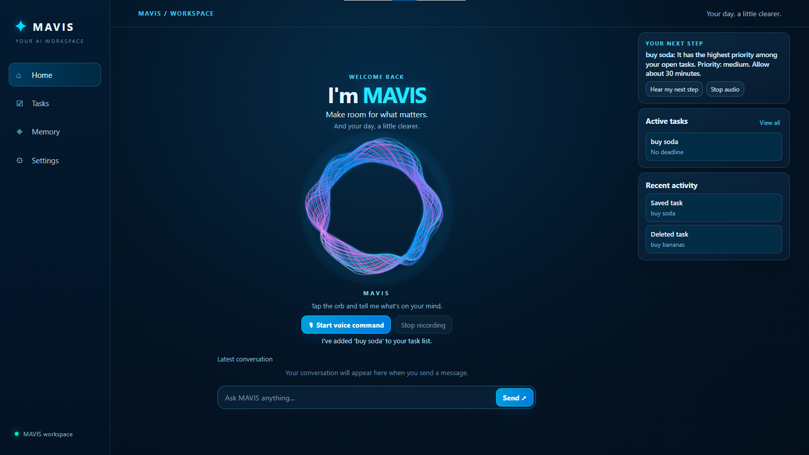

# MAVIS — Voice-First AI Productivity Assistant

**Meta Global AI Developer Hackathon | October–November 2026**

**MAVIS** is a voice-first AI productivity assistant that transforms natural conversation into meaningful, verified actions.

Powered by Meta Muse models, MAVIS combines conversational reasoning, task management, persistent memory, and proactive voice reminders.

**MAVIS doesn't just say an action was completed. It checks.**

## 1. Project Overview

**MAVIS — Make room for what matters** — is a voice-first AI productivity assistant built for the Meta Global AI Developer Hackathon. It transforms natural-language requests into useful actions while verifying supported changes against persistent application data.

MAVIS combines **Meta Muse Spark 1.3** for conversational reasoning and task interpretation, **Muse Voice Transcribe 1.0** for speech-to-text, and **Kokoro ONNX (Puck voice)** for natural spoken responses. The interface centers on a reactive holographic voice orb, with a workspace for tasks, persistent memory, and reminders.

**MAVIS doesn't just say an action was completed. It checks.** The Builder–Verifier workflow confirms supported task and memory changes in SQLite before reporting success. Clearly expressed commands can use deterministic routing, while less structured requests use Muse Spark.

### Features

- **Voice-first and text interaction:** Speak to the holographic orb or type a request; the interface displays listening, thinking, and speaking states.
- **Verified task management:** Create, view, complete, and delete tasks by name. Permanent deletion requires confirmation, and similar task names are handled cautiously.
- **Persistent memory:** Propose and approve saved facts, recall information across application restarts, and request verified memory deletion.
- **Reminders and proactive notifications:** Schedule reminders in natural language and receive visual and spoken notifications while the server and browser are running.
- **Prioritized workspace:** Review Your Next Step, active tasks, completed tasks, and Recent Activity drawn from recorded application actions.
- **Natural spoken responses:** Hear Kokoro ONNX's Puck voice, with model preloading, concise verified confirmations, and in-memory caching for five fixed confirmation phrases.
- **Builder–Verifier architecture:** Supported actions are independently checked against the database before success is reported.

### Interface Preview



*MAVIS home workspace — the holographic voice orb in the center, navigation on the left, and a live productivity overview on the right.*

The interface is designed to keep conversation at the center while giving users visibility into real task state and recently recorded actions. Its main views are **Home**, **Tasks**, **Memory**, and **Settings**.

## 2. Meta Models Used

MAVIS integrates two Meta AI models.

| Meta Model | Purpose | Where It Runs |
|---|---|---|
| Muse Spark 1.3 | Intent classification, conversational reasoning, and action extraction | Meta-hosted Model API |
| Muse Voice Transcribe 1.0 | Speech-to-text transcription of recorded voice commands | Meta-hosted Model API |

### Muse Spark 1.3

MAVIS uses Muse Spark 1.3 for conversational responses, intent classification when needed, and extraction of task or reminder details. Explicit task commands may be routed deterministically without a model classification call.

The Flask backend makes authenticated requests to:

`https://api.meta.ai/v1`

The model is accessed through Meta's hosted inference service, rather than running locally.

### Muse Voice Transcribe 1.0

MAVIS captures audio through the browser microphone.

FFmpeg converts the recording into mono, 24 kHz, 16-bit PCM WAV before the backend submits it to Meta's transcription endpoint:

`https://api.meta.ai/v1/asr/transcribe`

MAVIS then processes the transcript as a conversational command.

## 3. Open-Weight Model — Kokoro ONNX

MAVIS uses **Kokoro**, a pretrained, open-weight text-to-speech model, for natural voice responses.

The model is executed locally through the Kokoro ONNX Python package and ONNX Runtime.

### How It Works in MAVIS

1. Muse Spark or an application workflow produces response text.
2. MAVIS prepares the text for natural speech, including conversational date and time formatting.
3. The Flask `/api/tts` endpoint requests audio from the locally loaded Kokoro ONNX model.
4. Kokoro generates speech using the configured `am_puck` (Puck) voice.
5. The browser plays the generated audio while MAVIS displays its speaking state.

The model and voice files are loaded from `models/kokoro/`. The model is preloaded before Flask serves requests. Routine verified confirmations use concise spoken wording while the complete written answer remains visible, and a bounded in-memory cache reuses audio for five fixed confirmation phrases. Personalized speech is generated fresh.

The pretrained model weights are third-party components, not models trained by the MAVIS developer. They are downloaded separately rather than stored in the repository.

## 4. Technology Stack

| Technology | Role |
|---|---|
| Python | Backend logic and verification |
| Flask | Web application and REST API |
| SQLite | Persistent task, memory, and reminder storage |
| HTML, CSS, JavaScript | Interactive voice interface and dashboard |
| FFmpeg | Browser audio conversion |
| ONNX Runtime | Local Kokoro model inference |
| Git and GitHub | Version control and project distribution |

## 5. Getting Started — Run MAVIS From GitHub

These instructions describe how to run the hackathon implementation locally or through GitHub Codespaces.

### Prerequisites

- Python 3.12 recommended
- Git
- FFmpeg installed and accessible from the terminal
- Meta Model API key with access to Muse Spark 1.3 and Muse Voice Transcribe
- Internet access for the Meta APIs
- Kokoro ONNX model and voice files

### Step 1 — Clone the Repository

```bash
git clone --branch codex/task-dashboard --single-branch https://github.com/Ephyni/mavis-ai.git
cd mavis-ai
```

This checks out the branch containing MAVIS's current hackathon implementation.

### Step 2 — Create a Virtual Environment

**GitHub Codespaces, Linux, or macOS:**

```bash
python -m venv .venv
source .venv/bin/activate
```

**Windows PowerShell:**

```powershell
python -m venv .venv
.venv\Scripts\Activate.ps1
```

### Step 3 — Install Dependencies

```bash
python -m pip install -r requirements.txt
```

The dependency file includes Flask, Meta API client dependencies, Kokoro ONNX, and SoundFile.

FFmpeg is installed separately. For Ubuntu or Debian-based environments:

```bash
sudo apt-get update
sudo apt-get install -y ffmpeg
```

Verify FFmpeg:

```bash
ffmpeg -version
```

### Step 4 — Configure Your Meta Model API Key

The repository provides `.env.example` as a safe configuration template.

Copy it into a local `.env` file:

```bash
cp .env.example .env
```

On Windows PowerShell, use `Copy-Item .env.example .env`.

Configure the following values:

```dotenv
MODEL_API_KEY=your_meta_model_api_key
FLASK_SECRET_KEY=your_random_flask_secret
MAVIS_TIMEZONE=America/New_York
```

`MODEL_API_KEY` authenticates the backend requests to the Meta Model API.

`FLASK_SECRET_KEY` is required for Flask's session handling. Generate one with:

```bash
python -c "import secrets; print(secrets.token_hex(32))"
```

`MAVIS_TIMEZONE` controls how MAVIS interprets conversational reminder dates and times.

**Security:** Never add real credentials to `.env.example` or commit your private `.env` file. Each person running MAVIS must provide their own valid credentials.

### Step 5 — Download the Open-Weight Speech Model

Create the expected model directory:

```bash
mkdir -p models/kokoro
```

For GitHub Codespaces, Linux, or macOS, download the model and voice files:

```bash
curl -fL https://github.com/thewh1teagle/kokoro-onnx/releases/download/model-files-v1.0/kokoro-v1.0.onnx -o models/kokoro/kokoro-v1.0.onnx
```

```bash
curl -fL https://github.com/thewh1teagle/kokoro-onnx/releases/download/model-files-v1.0/voices-v1.0.bin -o models/kokoro/voices-v1.0.bin
```

Windows users can download the same two files from the [Kokoro ONNX releases](https://github.com/thewh1teagle/kokoro-onnx/releases) and place them in the matching directory.

Expected directory structure:

```text
models/
└── kokoro/
    ├── kokoro-v1.0.onnx
    └── voices-v1.0.bin
```

These files are intentionally excluded from Git because of their size.

### Step 6 — Launch the Application

```bash
python app.py
```

Open:

`http://localhost:5000`

In GitHub Codespaces, use the forwarded application URL for port 5000.

Allow microphone access when prompted.

## 6. How to Use MAVIS

### Start a Conversation

Click the interactive voice orb or select **Start voice command**.

MAVIS records your voice, transcribes it, interprets the request, and responds through its supported application workflows.

### Create a Task

**Say:**

“MAVIS, add study Python to my tasks.”

MAVIS saves the task and verifies its persistence.

### View Tasks

**Say:**

“MAVIS, show me my tasks.”

MAVIS retrieves the saved tasks and responds conversationally.

### Complete a Task by Name

**Say:**

“MAVIS, mark my study Python task as complete.”

MAVIS identifies the matching incomplete task by its saved name and independently verifies the completion.

The task name must uniquely identify an existing incomplete task. Users do not need to remember database IDs.

### Delete a Task

**Say:**

“MAVIS, delete my study Python task.”

MAVIS requests confirmation before executing the permanent deletion.

### Use Persistent Memory

**Say:** “MAVIS, remember that my demo code word is blue comet.”

MAVIS proposes saving the fact and asks for approval. After you confirm, it verifies that the fact was saved in SQLite. You can ask MAVIS to recall the saved fact, or request that it forget the memory; deletion requires confirmation.

The memory API also supports direct storage. For example, save a demonstration memory:

```bash
curl -X POST http://127.0.0.1:5000/api/memories \
  -H "Content-Type: application/json" \
  -d '{"content":"My MAVIS demo code word is blue comet."}'
```

Then ask:

“MAVIS, what is my MAVIS demo code word?”

Saved memories remain available after restarting the application.

### Create a Reminder

**Say:**

“MAVIS, remind me tomorrow at 3 PM to practice my presentation.”

MAVIS interprets the requested time, saves the reminder, and verifies the database record.

### Recall a Reminder

**Say:**

“MAVIS, what reminder did I just create?”

MAVIS retrieves the most recently saved reminder and responds using natural date and time pronunciation.

### Receive Proactive Notifications

When a scheduled reminder becomes due, MAVIS:

1. Detects it through periodic browser checks.
2. Displays an on-screen reminder notification.
3. Announces the message using Kokoro ONNX.
4. Provides a **Dismiss** button.
5. Records acknowledgment in SQLite to prevent repeated delivery.

Automatic notifications currently require the application server and browser tab to remain running.

## 7. Builder–Verifier Architecture

MAVIS separates execution from verification.

**Builder:** Interprets the requested action and executes the relevant Python or SQLite operation.

**Verifier:** Independently checks the resulting database state.

### Execution Workflow

```text
Voice or text command
      |
      v
Muse Voice Transcribe (for voice)
      |
      v
Intent resolution
  |                 |
  v                 v
Deterministic     Muse Spark 1.3
task routing      for less-structured requests
  |                 |
  +--------+--------+
           |
           v
Python application tool
      |
      v
SQLite database
      |
      v
Independent verification
      |
      v
Confirmed response
      |
      v
Kokoro ONNX speech
```

For supported operations, MAVIS reports successful execution only after the verifier confirms the expected database state.

This reduces the risk of presenting an AI-generated statement as proof that an action actually happened.

## 8. Before the Hackathon

MAVIS was started as a new application project during the October–November 2026 hackathon.

Before the event, I had experience with Python, Flask, REST API development, machine-learning fundamentals, and Git/GitHub.

My earlier, separate learning projects included:

- **Emotion Detection REST API:** A Flask application that processes text and returns emotion predictions through an API.
- **Postseason Prediction ML:** A machine-learning project exploring predictive modeling.

These projects provided relevant foundational experience but were not the MAVIS implementation.

The MAVIS application and its integrated workflows were developed for the hackathon.

Existing third-party libraries, pretrained AI models, and external APIs are credited separately.

## 9. Built During the Hackathon

During the event, I developed and integrated:

**Conversational AI**

- Muse Spark 1.3 intent classification and response generation
- Task extraction and execution routing
- Conversational task retrieval

**Voice Interaction**

- Browser microphone recording
- FFmpeg audio conversion
- Muse Voice Transcribe integration
- Kokoro ONNX speech responses

**Persistent Storage**

- SQLite task management
- Persistent user memories
- Memory-proposal review and approval
- Verified conversational memory deletion
- Reminder creation and retrieval

**Verified Execution**

- Independent database checks
- Verified task creation and completion
- Verified reminder persistence
- Reminder acknowledgment validation

**Proactive Assistance**

- Scheduled reminder detection
- Automatic browser-based notifications
- Spoken reminder announcements
- Duplicate-notification prevention

**User Interface**

- Voice-activated holographic orb
- Task dashboard, prioritized Next Step, and Recent Activity
- Listening, thinking, and speaking feedback

## 10. Testing and Verification

Run the repository's existing automated tests:

```bash
python -m unittest discover -s tests -v
```

Check Python syntax:

```bash
python -m py_compile app.py memory.py reminder_speech.py
```

Check JavaScript syntax:

```bash
node --check static/tasks.js
```

**Validation checkpoint:** All **43 automated tests passed** in GitHub Codespaces on November 4, 2026. These include tests for safe task selection, confirmed task and memory deletion, pending-command replacement, Kokoro speech caching, and voice configuration.

MAVIS has also undergone manual end-to-end testing of task actions, persistent memory, voice interactions, reminder scheduling, spoken notifications, and SQLite acknowledgment. The working voice interface was tested for creating a task immediately after an unfinished deletion request.

## 11. Timezone Handling

MAVIS uses `America/New_York` as its default timezone.

This standard IANA identifier also applies to New Jersey and automatically accounts for Eastern Standard Time and Eastern Daylight Time.

Reminder timestamps are stored in UTC and converted to the configured timezone for conversational responses.

The current prototype supports one configured timezone per application instance.

## 12. Current Limitations

- Local, single-user prototype
- No production authentication or deployment safeguards
- Internet access required for Meta-hosted inference
- Automatic reminders require the application and browser to remain open
- Browser audio permissions can affect automatic playback
- Open-weight speech model files must be downloaded separately

## 13. Future Expansions

MAVIS is a working hackathon prototype with a foundation for further agentic capabilities. Potential future directions include deeper email and calendar integrations, more flexible multi-step workflow orchestration, and further reduction of open-ended conversational response latency.

These are future possibilities, **not features claimed to be implemented in this prototype**. The current release focuses on reliable voice-driven task actions, persistent memory, reminders, and verified execution.

## 14. Three-Minute Demonstration

**Demo video (2 minutes 46 seconds):** [Watch the MAVIS demo](MAVIS-demo.mp4)

[Download the demo video (MP4)](https://github.com/Ephyni/mavis-ai/raw/refs/heads/main/MAVIS-demo.mp4?download=1)

The demonstration shows creating a task by voice, preserving it after a page refresh, and marking it complete with database verification, followed by a brief explanation of the architecture.

## 15. License

See [LICENSE](LICENSE).
